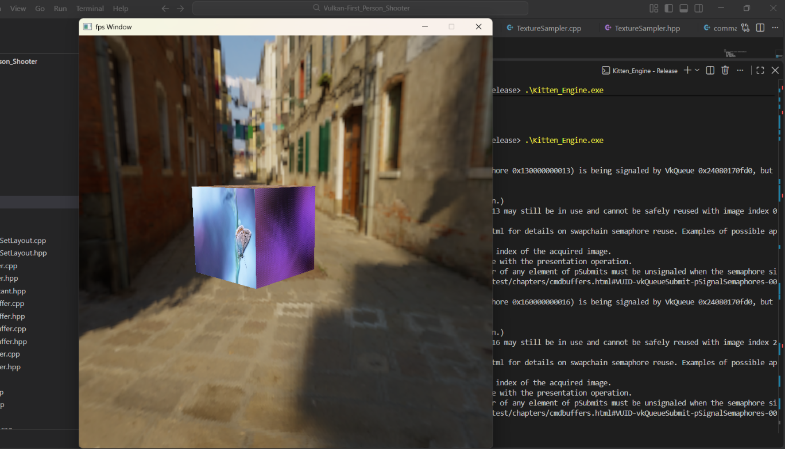

This project is in progress....
the textures for the cube is in the ./engine/Resources/cube_textures
the texture images for the ./engine/Resources/easy_cubemap

the applications boots from the main.cpp in the ./engine/main.cpp
the all the external 3D models and textures are stored in the ./engine/Resources this Resources folder is then copied to the executable directory and directlly referred from their during the engine execution
the spirv compilled files for the shader files in the ./engine/shaders are also moved to the executable directory

Tech used:
c++
vulkan 1.3 
GLSLC
cmake
stb_image.h

The engine starts from the engine/main.cpp

This is what the final output of the enigne looks like as of now: 
